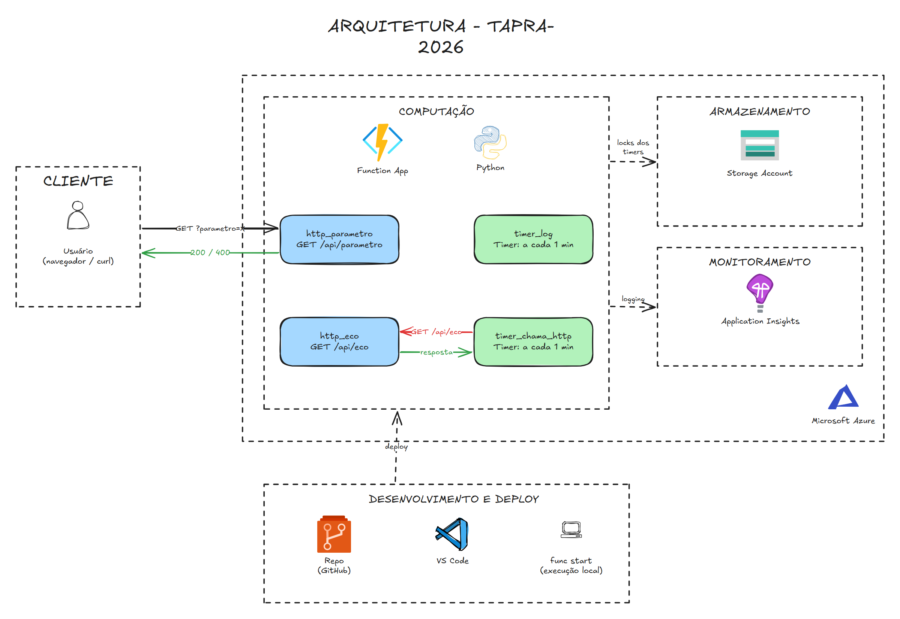
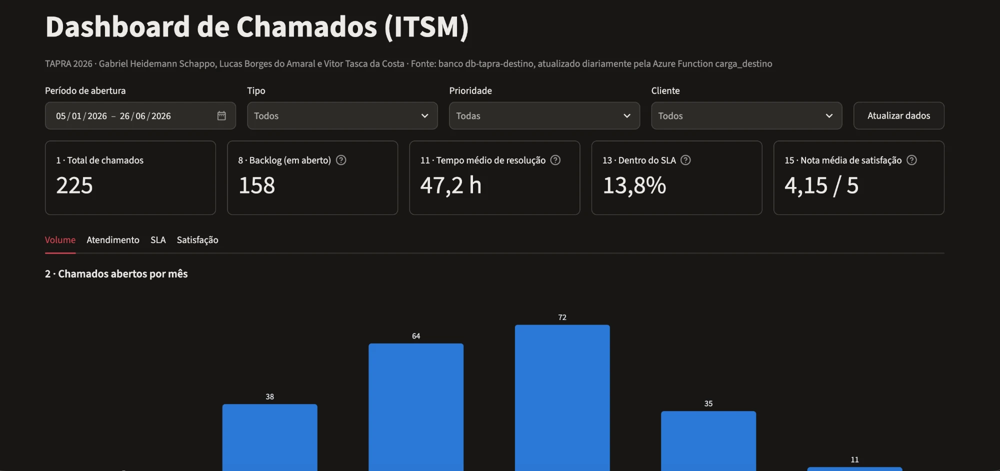
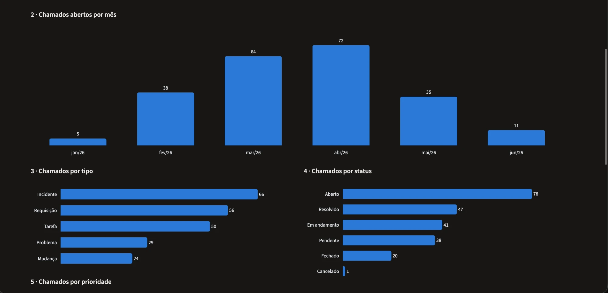
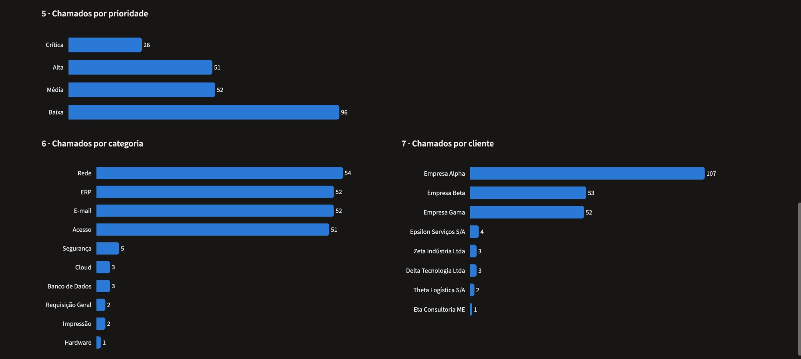

# TAPRA-2026

Projeto da disciplina de **Tópicos Avançados em Programação (TAPRA)** — 2026.

## Integrantes da equipe

- Gabriel Heidemann Schappo
- Lucas Borges do Amaral
- Vitor Tasca da Costa

## Arquitetura

## Dashboard

Dashboard em Streamlit com os do projeto, calculados sobre o banco de destino.

